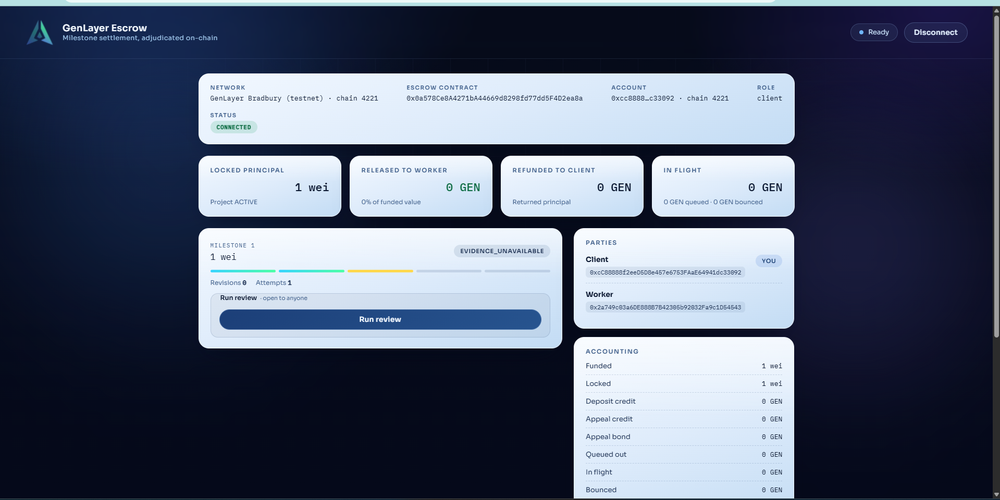
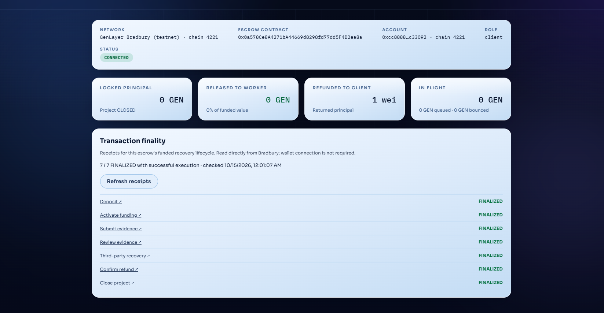
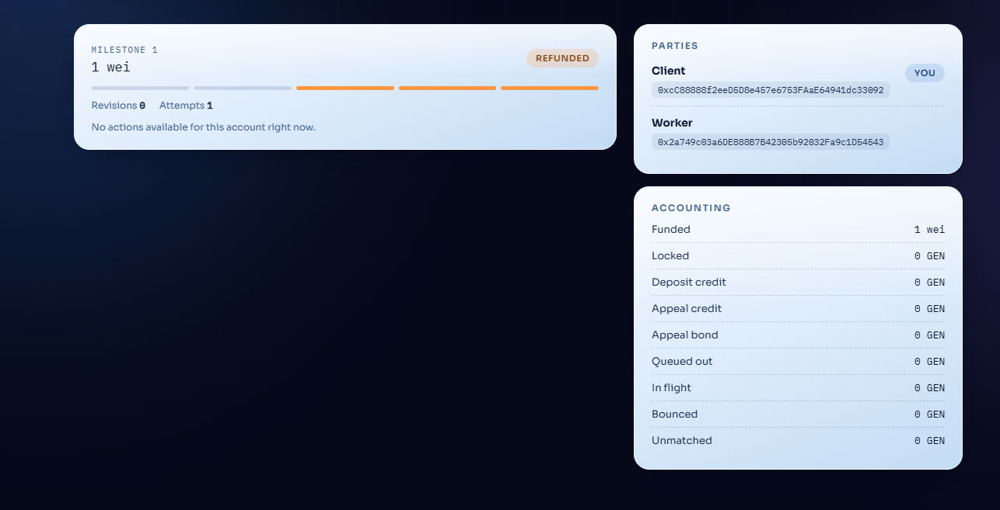

# Bradbury funded evidence-liveness proof — 2026-10-14

The corrected escrow completed a funded recovery lifecycle on Bradbury. A deliberately unavailable pinned evidence URL produced `EVIDENCE_UNAVAILABLE`. After the real 72-hour recovery window, an account distinct from both beneficiaries recovered the principal. The 1 wei refund settled and the project closed.

All seven lifecycle transactions were read from Bradbury as **FINALIZED / AGREE / FINISHED_WITH_RETURN** in the operator's PowerShell verification on 2026-10-14. The published frontend independently read all seven receipts and displayed successful finality on 2026-10-15 at approximately 00:01 Istanbul time.

## Corrected deployment

- Network: Bradbury testnet, chain ID **4221**.
- Escrow: `0x0a578Ce8A4271bA44669d8298fd77dd5F4D2ea8a`.
- This evidence concerns the corrected deployment, not the earlier escrow at `0x9304455A1Bad15A6317E1d4de92c9b599bae246C`.
- [Deployment EVM receipt](https://zksync-os-testnet-genlayer.explorer.zksync.dev/tx/0x15b28cce90d8b933063944774f4cd752812d1442763db390b76aa06a1483e69d).
- [Deployment GenLayer receipt](https://explorer-bradbury.genlayer.com/tx/0x5b6e57dc6f9ec84701c487668bfbb100b25628bff5d6516fbe8a599452852178).
- Deployment finality was verified before funding; deployment execution agreed and returned successfully.
- [Deployment source reference](https://github.com/Shahin021/EscrowWithIntelligentReview/blob/ec5c15e508227dc377c39349a169478b40e4254c/contracts/project_escrow.py).
- [Evidence-liveness fix](evidence-liveness-fix-2026-10-10.md).

## Participants and funded amount

| Role | Address |
| --- | --- |
| Client / refund recipient | `0xcC88888f2eeD5D8e457e6753FAaE64941dc33092` |
| Worker | `0x2a749c03a6DE888B7B42305b92032Fa9c1D54543` |
| Recovery, confirmation and closure sender | `0x8e4bE3732C49aEee4aC6D8e3131Cb4F85Ab1Af53` |

Milestone index **0** (displayed as Milestone 1 in the frontend) was funded with **1 wei**. The recovery sender is neither the client nor the worker, demonstrating the recovery method's permissionless access. Client and worker addresses were read from the contract. The third party supplied gas; the principal was returned to the client.

## Unavailable evidence and real recovery window

The worker submitted this deliberately nonexistent commit-pinned URL:

```
https://raw.githubusercontent.com/Shahin021/EscrowWithIntelligentReview/0000000000000000000000000000000000000000/evidence/missing.html
```

Review produced `EVIDENCE_UNAVAILABLE`. The recovery deadline was **2026-10-14 19:17 UTC / 22:17 Istanbul**. The configured 72 hours comprise the 48-hour replacement grace and 24-hour review-stall window. The deployed window was not shortened for this proof. A read-only rehearsal after the deadline confirmed that chain time had passed it before recovery was submitted.

## Finalized lifecycle receipts

Every row below was verified as **FINALIZED / AGREE / FINISHED_WITH_RETURN**. These are GenLayer transaction IDs; the links use the GenLayer explorer.

| Method | Sender role | GenLayer receipt |
| --- | --- | --- |
| `fund` | Client | [0x4dbf2bc65654eeec2e6e520509911a45d5d5b2192a8dae859a9a9215ddf773fe](https://explorer-bradbury.genlayer.com/tx/0x4dbf2bc65654eeec2e6e520509911a45d5d5b2192a8dae859a9a9215ddf773fe) |
| `activate_funding` | Client | [0x6b0a8c3a25435d80e51e21970d7aff26ade221b17debf9ce187f897c56b5c197](https://explorer-bradbury.genlayer.com/tx/0x6b0a8c3a25435d80e51e21970d7aff26ade221b17debf9ce187f897c56b5c197) |
| `submit_deliverable` | Worker | [0x3949ecc7ebb58c52e74398ff65bbd2df8aa130e650eaf9175ba8390283efc2cf](https://explorer-bradbury.genlayer.com/tx/0x3949ecc7ebb58c52e74398ff65bbd2df8aa130e650eaf9175ba8390283efc2cf) |
| `resolve` | Client | [0x75f0ca984c9c5244c3a801fe3cabd2539ed5681743a165ca0deca4d3a1950382](https://explorer-bradbury.genlayer.com/tx/0x75f0ca984c9c5244c3a801fe3cabd2539ed5681743a165ca0deca4d3a1950382) |
| `recover_unavailable_evidence` | Third party | [0x6a14849738418854f6990a45e3fa343a37d0531f2591ef9bb22d67b5bd1bd0a3](https://explorer-bradbury.genlayer.com/tx/0x6a14849738418854f6990a45e3fa343a37d0531f2591ef9bb22d67b5bd1bd0a3) |
| `confirm_outflow` | Third party | [0x4892263642e78ff18a98358a6163e63196a284ad307d5b1c7437477c79386c8c](https://explorer-bradbury.genlayer.com/tx/0x4892263642e78ff18a98358a6163e63196a284ad307d5b1c7437477c79386c8c) |
| `close_project` | Third party | [0xec91f46e0f949368894bea5f1934d6a72a181772b46e76682b88501db96c3c52](https://explorer-bradbury.genlayer.com/tx/0xec91f46e0f949368894bea5f1934d6a72a181772b46e76682b88501db96c3c52) |

The funding transaction's EVM hash is separately recorded as `0xae475aa32e25526fd8d6637a32b472cc71d72e267bfc42125416770f40dcda42`. Funding was not resent when local receipt waiting timed out.

## Refund settlement and closure

Recovery queued and emitted outflow **0**, kind **PROJECT_REMAINDER_REFUND**, with **1 wei** payable to the contract's client. No separate `emit_next_outflow` transaction was needed: recovery emitted the queued refund itself.

Before `confirm_outflow(0)`, the runner checked the outflow kind, recipient, principal amount and `EMITTED` status. It initially stopped because the contract still held the 1 wei. After recovery finalized, a new native balance read returned **0 wei**, matching the remaining ledger buckets, while the 1 wei outflow was still awaiting accounting confirmation. The runner then confirmed the refund and closed the project. The confirmation and closure receipts subsequently finalized successfully.

The client's total native balance was read, but no before/after recipient balance delta was available for this automatically emitted outflow. This report does not claim an independently measured client balance increase. Settlement evidence consists of the matched client-directed outflow, the contract balance drop, successful finalized confirmation and the final accounting state.

| Final field | Value |
| --- | --- |
| Project | `CLOSED` |
| Milestone 0 | `REFUNDED` |
| Total funded | 1 wei |
| Total refunded to client | 1 wei |
| Released to worker | 0 |
| Locked | 0 |
| Deposit credit | 0 |
| Queued out | 0 |
| In flight | 0 |
| Bounced / unmatched / appeal credit / appeal bond | 0 |
| Escrow native balance, read before confirmation | 0 wei |

## Live frontend evidence

[Published corrected dashboard](https://shahin021.github.io/EscrowWithIntelligentReview/).

The operator connected the client wallet on Bradbury and loaded the corrected contract in the live frontend. The first screenshot records the unavailable-evidence state. The final screenshots record successful live receipt reads and refunded accounting after closure. Lifecycle writes were performed using the runner; these screenshots demonstrate wallet connection, live frontend reads and receipt verification, not frontend-originated lifecycle writes.

### Before recovery



### Finality verified from the live frontend



### Final refunded accounting



## Validation records

- Evidence-liveness patch validation recorded on 2026-10-10: **563 Python tests**, **86 frontend tests**, production build passed.
- Installed live runner validation: **122 offline tests passed** on the operator's Windows environment.
- Receipt-panel change: **100 frontend tests passed** and production build passed before publication.
- GitHub PR #4 build and Direct Mode checks passed; it merged into `main`, and the subsequent Pages publication succeeded.
- The final dashboard successfully read **7 / 7** successful finalized lifecycle receipts.

This is a funded, 1 wei Bradbury testnet liveness proof for the unavailable-evidence path. It does not establish live coverage of every escrow dispute or settlement path.
